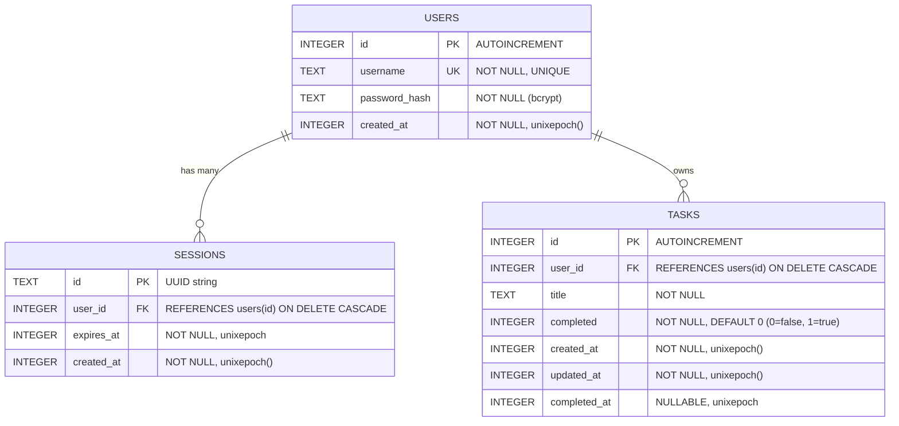

# Database Design & Schema Specification — Cloudflare D1

**Document:** `design/database_design.md`  
**Database Engine:** Cloudflare D1 (Serverless SQLite at the edge)  
**Status:** Current Implementation (`0001_init.sql`)  
**Scope:** Tables, Relationships, Constraints, and Indexes  
**Last Updated:** October 2026  

---

## 1. Entity-Relationship (ER) Diagram



---

## 2. Table Schemas

### 2.1 `users`
Stores user accounts.

| Column | Type | Constraints | Description |
| :--- | :--- | :--- | :--- |
| `id` | `INTEGER` | `PRIMARY KEY AUTOINCREMENT` | Unique user identifier. |
| `username` | `TEXT` | `NOT NULL UNIQUE` | Lowercase sanitized username. |
| `password_hash` | `TEXT` | `NOT NULL` | `bcrypt-ts` hash (10 salt rounds). |
| `created_at` | `INTEGER` | `NOT NULL DEFAULT (unixepoch())` | Account creation timestamp (epoch seconds). |

---

### 2.2 `sessions`
Stores active browser sessions for cookie-based authentication (`session_id`).

| Column | Type | Constraints | Description |
| :--- | :--- | :--- | :--- |
| `id` | `TEXT` | `PRIMARY KEY` | Cryptographically random UUID (`crypto.randomUUID()`). |
| `user_id` | `INTEGER` | `NOT NULL`, FK ➜ `users(id)` | User owning the session (`ON DELETE CASCADE`). |
| `expires_at` | `INTEGER` | `NOT NULL` | Session expiration timestamp (epoch seconds). |
| `created_at` | `INTEGER` | `NOT NULL DEFAULT (unixepoch())` | Session creation timestamp (epoch seconds). |

**Index:**
* `idx_sessions_user_id` on `sessions(user_id)` — fast lookup when invalidating prior sessions during login (single-device policy).

---

### 2.3 `tasks`
Stores user todo and execution items.

| Column | Type | Constraints | Description |
| :--- | :--- | :--- | :--- |
| `id` | `INTEGER` | `PRIMARY KEY AUTOINCREMENT` | Unique task identifier. |
| `user_id` | `INTEGER` | `NOT NULL`, FK ➜ `users(id)` | Task owner (`ON DELETE CASCADE`). |
| `title` | `TEXT` | `NOT NULL` | Task content. |
| `completed` | `INTEGER` | `NOT NULL DEFAULT 0` | Completion flag (`0` = active, `1` = completed). |
| `created_at` | `INTEGER` | `NOT NULL DEFAULT (unixepoch())` | Creation timestamp (epoch seconds). |
| `updated_at` | `INTEGER` | `NOT NULL DEFAULT (unixepoch())` | Last modification timestamp (epoch seconds). |
| `completed_at` | `INTEGER` | `NULLABLE` | Timestamp when marked completed (`NULL` if active). |

**Index:**
* `idx_tasks_user_id` on `tasks(user_id)` — fast filtering when fetching a user's task list.

---

## 3. Data Integrity & Design Decisions

1. **Cascading Deletions:**  
   Both `sessions` and `tasks` enforce:
   ```sql
   FOREIGN KEY (user_id) REFERENCES users(id) ON DELETE CASCADE
   ```
   Deleting a user account automatically deletes all their sessions and tasks, preventing orphaned rows.

2. **Unix Epoch Timestamps (`INTEGER`):**  
   All timestamps are stored as 64-bit integer Unix epoch seconds using SQLite's native `unixepoch()`.

3. **Boolean Storage:**  
   SQLite has no native `BOOLEAN` type. Booleans are stored as `INTEGER` (`0` = false/active, `1` = true/completed).
