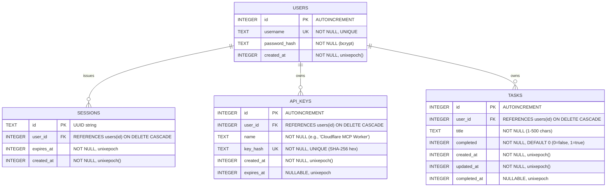

# Database Design & Schema Specification — Cloudflare D1

**Document:** `design/database_design.md`  
**Database Engine:** Cloudflare D1 (Serverless SQLite at the edge)  
**Scope:** Core Schemas, Relationships, Constraints, and Indexes  
**Last Updated:** October 2026  

---

## 1. Entity-Relationship (ER) Diagram



---

## 2. Table Schemas

### 2.1 `users`
Stores user accounts.

| Column | Type | Constraints | Description |
| :--- | :--- | :--- | :--- |
| `id` | `INTEGER` | `PRIMARY KEY AUTOINCREMENT` | Unique user identifier. |
| `username` | `TEXT` | `NOT NULL UNIQUE` | Lowercase trimmed username. |
| `password_hash` | `TEXT` | `NOT NULL` | `bcrypt-ts` hash (10 salt rounds). |
| `created_at` | `INTEGER` | `NOT NULL DEFAULT (unixepoch())` | Account creation timestamp (Unix epoch seconds). |

---

### 2.2 `sessions`
Stores active browser sessions for cookie-based authentication (`session_id`).

| Column | Type | Constraints | Description |
| :--- | :--- | :--- | :--- |
| `id` | `TEXT` | `PRIMARY KEY` | Cryptographically random UUID (`crypto.randomUUID()`). |
| `user_id` | `INTEGER` | `NOT NULL`, FK ➜ `users(id)` | User owning the session (`ON DELETE CASCADE`). |
| `expires_at` | `INTEGER` | `NOT NULL` | Session expiration timestamp (Unix epoch seconds). |
| `created_at` | `INTEGER` | `NOT NULL DEFAULT (unixepoch())` | Session issuance timestamp (Unix epoch seconds). |

**Index:**
* `idx_sessions_user_id` on `sessions(user_id)` — fast lookup when invalidating prior sessions during login (single-device policy).

---

### 2.3 `api_keys`
Stores hashed Personal Access Tokens / API keys for headless services (Cloudflare MCP Worker, CLI).

| Column | Type | Constraints | Description |
| :--- | :--- | :--- | :--- |
| `id` | `INTEGER` | `PRIMARY KEY AUTOINCREMENT` | Unique key identifier. |
| `user_id` | `INTEGER` | `NOT NULL`, FK ➜ `users(id)` | User owning the key (`ON DELETE CASCADE`). |
| `name` | `TEXT` | `NOT NULL` | Client label (e.g. `"Cloudflare MCP Worker"`). |
| `key_hash` | `TEXT` | `NOT NULL UNIQUE` | SHA-256 hexadecimal hash of the plain token. |
| `created_at` | `INTEGER` | `NOT NULL DEFAULT (unixepoch())` | Key creation timestamp (Unix epoch seconds). |
| `expires_at` | `INTEGER` | `NULLABLE` | Optional key expiration timestamp (null = never). |

**Index:**
* `idx_api_keys_hash` on `api_keys(key_hash)` — fast index lookup during Bearer token authentication.

---

### 2.4 `tasks`
Stores user todo and execution items.

| Column | Type | Constraints | Description |
| :--- | :--- | :--- | :--- |
| `id` | `INTEGER` | `PRIMARY KEY AUTOINCREMENT` | Unique task identifier. |
| `user_id` | `INTEGER` | `NOT NULL`, FK ➜ `users(id)` | Task owner (`ON DELETE CASCADE`). |
| `title` | `TEXT` | `NOT NULL` | Task content (1–500 characters). |
| `completed` | `INTEGER` | `NOT NULL DEFAULT 0` | Completion status (`0` = active, `1` = completed). |
| `created_at` | `INTEGER` | `NOT NULL DEFAULT (unixepoch())` | Creation timestamp (Unix epoch seconds). |
| `updated_at` | `INTEGER` | `NOT NULL DEFAULT (unixepoch())` | Last update timestamp (Unix epoch seconds). |
| `completed_at` | `INTEGER` | `NULLABLE` | Timestamp when marked completed (`NULL` if active). |

**Index:**
* `idx_tasks_user_id` on `tasks(user_id)` — enables fast multi-tenant filtering when fetching task lists.

---

## 3. Data Integrity & Design Decisions

1. **Cascading Deletions:**  
   All child tables (`sessions`, `api_keys`, `tasks`) declare:
   ```sql
   FOREIGN KEY (user_id) REFERENCES users(id) ON DELETE CASCADE
   ```
   Deleting a user automatically purges all associated sessions, tokens, and tasks.

2. **Unix Epoch Timestamps (`INTEGER`):**  
   Dates are stored as 64-bit integer epoch seconds using SQLite's native `unixepoch()` function. This ensures compact storage, fast numeric sorting (`ORDER BY created_at DESC`), and simple TTL comparisons (`expires_at > unixepoch()`).

3. **Boolean Handling:**  
   SQLite lacks a native boolean type. Booleans are stored as `INTEGER` (`0` for false, `1` for true).

4. **Token Security:**
   * Session IDs are opaque UUIDs stored as plaintext primary keys.
   * API keys are hashed with **SHA-256** before storage. Raw keys are never stored in the database.
