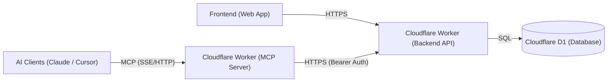

# High-Level Design (HLD) — Personal Second Brain & Execution System

**Document:** `design/hld.md`  
**Status:** Approved Architectural Baseline  
**Scope:** End-to-End System Architecture (Frontend, Edge Backend, D1 Persistence, Dual-Auth, MCP AI Layer)  
**Last Updated:** October 2026  

---

## 1. System Overview

The **Personal Second Brain & Execution System** is an edge-first task capture and execution platform.

The system provides two client interfaces backed by a single source of truth:
1. **Web Dashboard:** Browser client for visual task management, backlog triage, and tracking.
2. **AI Agent Interface (MCP):** A Cloudflare Worker running an MCP server that enables natural-language task management for AI clients (Claude, Cursor, etc.).

All client operations route through an edge API gateway (Cloudflare Worker) to a serverless relational database (Cloudflare D1 SQLite).

---

## 2. System Architecture Diagram

---

## 3. Component Breakdown

### 3.1 Web Dashboard (`brain_frontend`)
* **Technology:** React 19, TypeScript, Vite.
* **Styling System:** Modern Vanilla CSS design system (zero Tailwind).
  * Obsidian dark canvas (`#07080a`) with electric vermilion accents (`#ff4624`).
  * Editorial Japanese paper light mode (`[data-theme="light"]`).
  * Dot-grid blueprint canvas, levitating UI widgets, and Outcrowd-inspired split-screen narrative showcase.
* **Network Communication:**
  * Uses browser `fetch` with `credentials: 'include'` on all calls to `/api_brain/*`.
  * Zero client-side token storage in `localStorage` or `sessionStorage` (XSS-proof).
  * Initial boot calls `GET /api_brain/auth/me` to determine whether to render the dashboard or the authentication gateway.

### 3.2 Conversational AI Layer (`brain_mcp`)
* **Technology:** Cloudflare Workers, TypeScript, Model Context Protocol (MCP) TypeScript SDK.
* **Execution Environment:** Runs as a serverless edge Cloudflare Worker, exposing remote MCP transport over SSE / HTTP.
* **Communication:**
  * AI clients (Claude Desktop, Cursor, ChatGPT) connect remotely over the network.
  * Translates tool calls (`create_task`, `list_tasks`, `toggle_task`, `delete_task`) into authenticated HTTPS calls with `Authorization: Bearer <BRAIN_API_KEY>` to the Backend Worker.
  * Relays structured results back to the AI model's context stream.

### 3.3 Edge API Worker (`brain_backend`)
* **Technology:** Cloudflare Workers, Hono web framework (`^4.x`), TypeScript.
* **Domain & Base Path:** `https://dev.mohakapoor.in/api_brain` (production: `https://brain.mohakapoor.in/api_brain`).
* **Key Modules:**
  * **CORS Guard (`middleware/cors.ts`):** Allows only approved origins (`*.mohakapoor.in`, `localhost:5173`) with credentials enabled.
  * **Input Validation (`schemas/*`):** Zod 4 schemas validate and sanitize all JSON request payloads before controller execution.
  * **Dual Authentication (`middleware/auth.ts`):** Transparently verifies session cookies (Web) or Bearer tokens (MCP/CLI) and injects the authenticated `user` into the request context.
  * **Domain Controllers:**
    * `routes/auth.ts`: Registration (invite-guarded), login, logout, and `/me`.
    * `routes/tasks.ts`: Task CRUD with incomplete-first ordering.

### 3.4 Relational Storage (`Cloudflare D1`)
* **Engine:** Serverless SQLite at Cloudflare's edge.
* **Schema Integrity:** Foreign keys enforce `ON DELETE CASCADE`. If a user is deleted, all their sessions, API keys, and tasks are wiped automatically.
* **Epoch Timestamps:** All dates are stored as standard 64-bit Unix timestamps (`unixepoch()`) for minimal storage overhead and high-speed indexing.

---

## 4. Authentication & Security

The edge API implements a **Dual-Authentication** strategy:
* **Web Dashboard:** Database-backed `HttpOnly` session cookies (`session_id`).
* **MCP Server / Headless:** `Authorization: Bearer <api_key>` header verified against SHA-256 hashed keys.

### Core Security Controls
* **Multi-Tenant Isolation:** Every data query and mutation is strictly scoped to the authenticated `user_id`.
* **Invite-Only Registration:** Signup requires an `inviteCode` validated against edge worker environment secrets.
* **Origin Boundary:** CORS middleware restricts browser access to approved domains (`*.mohakapoor.in`, local dev).

---

## 5. End-to-End Data Flows

### 5.1 Web Dashboard: User Journey
1. **Bootstrap (`GET /auth/me`):**
   * App initializes. Calls `/auth/me` with `credentials: 'include'`.
   * If `200 OK`: user context is hydrated; renders `DashboardView`.
   * If `401 Unauthorized`: renders `AuthGateway` (Login/Register card).
2. **Task Creation (`POST /tasks`):**
   * User types into quick-capture input and hits `Enter`.
   * Payload `{ title: string }` validated by Zod schema (1–500 chars).
   * Edge worker inserts record into D1 with `completed = 0`.
   * Returns `201 Created` with full task row; UI prepends to list optimistically.
3. **Task Completion Toggle (`PATCH /tasks/:id`):**
   * Checkbox clicked. Dispatches `{ completed: true }`.
   * Server updates `completed = 1` and `completed_at = unixepoch()`.
   * Returns updated task; UI shifts item to the completed section with strikethrough transition.

### 5.2 MCP Conversational Agent: User Journey
1. **User Prompt:** "Claude, add 'Draft distributed systems memo' to my tasks."
2. **MCP Tool Selection:** Claude identifies the `create_task` tool with argument `{ title: "Draft distributed systems memo" }`.
3. **Execution:** Brain MCP server reads `BRAIN_API_KEY` from environment, performs `POST https://dev.mohakapoor.in/api_brain/tasks` with `Authorization: Bearer <key>`.
4. **Edge Processing:** Worker validates SHA-256 hash, attaches user, creates D1 row.
5. **Feedback Loop:** MCP server returns JSON to Claude; Claude informs the user: *"Added 'Draft distributed systems memo' to your tasks."*
6. **Instant Visibility:** Next time the user opens or refreshes the Web Dashboard, the new task is immediately present.

---

## 6. Infrastructure & Deployment Topology

| Component | Provider / Platform | Environment | Hostname |
| :--- | :--- | :--- | :--- |
| **Frontend SPA** | Vercel | Production | `brain.mohakapoor.in` |
| **Edge API Worker** | Cloudflare Workers | Dev / Staging | `dev.mohakapoor.in` |
| **Edge API Worker** | Cloudflare Workers | Production | `api.mohakapoor.in` / `brain.mohakapoor.in/api_brain` |
| **MCP Server Worker** | Cloudflare Workers | Dev / Prod | `mcp.mohakapoor.in` |
| **Database** | Cloudflare D1 | Isolated Dev | `brain-dev` |
| **Database** | Cloudflare D1 | Isolated Prod | `brain-prod` |
| **CI/CD** | GitHub Actions | Automated Pipeline | Lint, Typecheck, Migrations, Deploy |

---

## 7. Evolution & Roadmap Beyond Phase 1

1. **Phase 1 (Current):**
   * Core Todo & Task Foundation.
   * Remote D1 CRUD + Session Cookie Auth + Landing Showcase.
2. **Phase 2 (Immediate Next):**
   * Dual-Auth Middleware implementation (`sessions` + `api_keys`).
   * Cloudflare Worker `brain_mcp` server deployment (remote SSE/HTTP transport for Claude & Cursor).
   * Authenticated Web Dashboard views (Inbox, Today queue, Completed archive).
3. **Phase 3 (Expansion):**
   * Peripheral Life Modules (as previewed in [BeyondTasksShowcase.tsx](file:///c:/Users/mohak/OneDrive/Documents/Projects/brain/brain_frontend/src/components/BeyondTasksShowcase.tsx)):
     * Personal Finance & Burn Rate Telemetry.
     * Fitness & Kinetic Tonnage Tracking.
     * Knowledge Artifacts & Reference Library.
