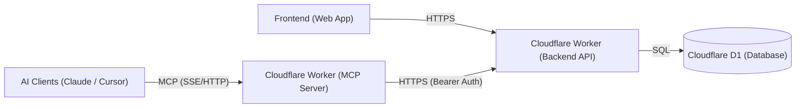

# High-Level Design (HLD) — Personal Second Brain & Execution System

**Document:** `design/hld.md`  
**Status:** Approved Architectural Baseline  
**Scope:** Core System Architecture  
**Last Updated:** October 2026  

---

## 1. System Overview

The **Personal Second Brain & Execution System** is an edge-first task capture and execution platform.

The system provides two client interfaces backed by a single source of truth:
1. **Web Dashboard:** Browser client for visual task management, backlog triage, and tracking.
2. **AI Agent Interface (MCP):** A Cloudflare Worker running an MCP server enabling natural-language task management for AI clients (Claude, Cursor, etc.).

All client operations route through an edge API gateway (Cloudflare Worker) to a serverless relational database (Cloudflare D1 SQLite).

---

## 2. System Architecture Diagram

---

## 3. Core Components

1. **Web Dashboard (`brain_frontend`):**
   * React SPA hosted on Vercel (`brain.mohakapoor.in`).
   * Interacts with the backend via HTTPS using credentials (`HttpOnly` session cookie).

2. **MCP Server Worker (`brain_mcp`):**
   * Cloudflare Worker exposing remote MCP endpoints (SSE/HTTP) for AI clients.
   * Translates AI tool calls into authenticated REST requests (`Bearer <api_key>`) to the backend API.

3. **Backend API Worker (`brain_backend`):**
   * Cloudflare Worker running Hono on custom domain (`dev.mohakapoor.in/api_brain`).
   * Handles CORS, dual authentication, request validation, and task business logic.

4. **Database (`Cloudflare D1`):**
   * Serverless distributed SQLite storing users, sessions, API keys, and tasks.

---

## 4. Authentication & Security

The edge API implements a **Dual-Authentication** strategy:
* **Web Dashboard:** Database-backed `HttpOnly` session cookies (`session_id`).
* **MCP Server / Headless:** `Authorization: Bearer <api_key>` header verified against SHA-256 hashed keys in D1.

### Core Security Controls
* **Multi-Tenant Isolation:** All queries and mutations are strictly scoped by authenticated `user_id`.
* **Invite-Only Registration:** Signup requires a secret `inviteCode` validated by the Worker.
* **Origin Boundary:** CORS restricted to approved domains (`*.mohakapoor.in`, local dev).

---

## 5. Deployment Topology

| Component | Platform | Environment | Domain / Identifier |
| :--- | :--- | :--- | :--- |
| **Frontend** | Vercel | Production | `brain.mohakapoor.in` |
| **Backend API** | Cloudflare Workers | Dev / Prod | `dev.mohakapoor.in` / `api.mohakapoor.in` |
| **MCP Server** | Cloudflare Workers | Dev / Prod | `mcp.mohakapoor.in` |
| **Database** | Cloudflare D1 | Isolated Dev / Prod | `brain-dev` / `brain-prod` |

---

## 6. Phased Roadmap

* **Phase 1 (Current):** Core Todo & Task Foundation (Remote D1 CRUD + Web Landing/Dashboard + Session Cookie Auth).
* **Phase 2 (Immediate Next):** Dual Auth (API Keys) + Cloudflare Worker MCP Server.
* **Phase 3 (Expansion):** Peripheral Life Trackers (Finance, Fitness, Notes).
